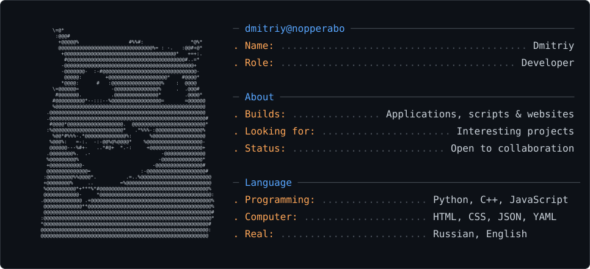

  <pre align="center">
   _   ______  ____  ____  __________  ___    ____  ____
  / | / / __ \/ __ \/ __ \/ __/ / __ \/   |  / __ )/ __ \
 /  |/ / / / / /_/ / /_/ / /_/ / /_/ / /| | / __  / / / /
/ /|  / /_/ / ____/ ____/ /___/ / , _/ ___ |/ /_/ / /_/ /
/_/ |_/____/_/   /_/   /_____/ /_/|_/_/  |_/_____/_____/
  </pre>

 

<picture>
  <source media="(prefers-color-scheme: dark)" srcset="https://raw.githubusercontent.com/iamnopperabo/iamnopperabo/7c6a239f9ef00ddd63c77e31b10d909fe5254b0d/profile-card-dark.svg" />
  <source media="(prefers-color-scheme: light)" srcset="https://raw.githubusercontent.com/iamnopperabo/iamnopperabo/b4ce205bc3c46796fb3bac6b120ea55d0b18df1f/profile-card-light.svg" />
  
</picture>

 

  
  &nbsp;
  

 

  
  &nbsp;&nbsp;&nbsp;
  
  &nbsp;&nbsp;&nbsp;
  

 

  
  &nbsp;&nbsp;
  
  &nbsp;&nbsp;
  
  &nbsp;&nbsp;
  
  &nbsp;&nbsp;
  
  &nbsp;&nbsp;
  
  &nbsp;&nbsp;
  

  
  &nbsp;&nbsp;
  
  &nbsp;&nbsp;
  
  &nbsp;&nbsp;
  
  &nbsp;&nbsp;
  

  
  &nbsp;&nbsp;
  
  &nbsp;&nbsp;
  
  &nbsp;&nbsp;
  

  
  &nbsp;&nbsp;
  
  &nbsp;&nbsp;
  

